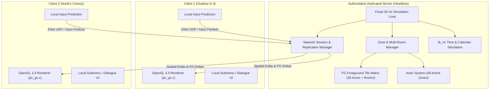
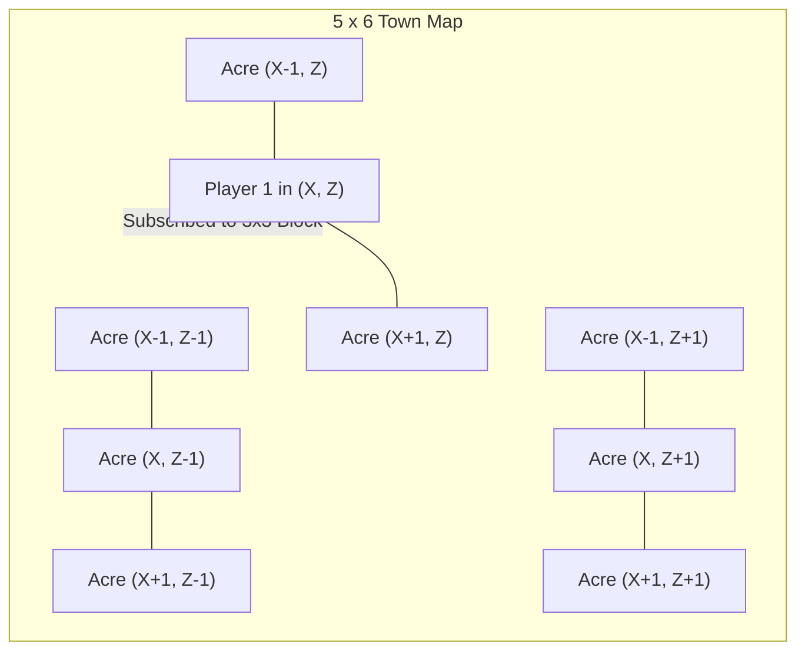
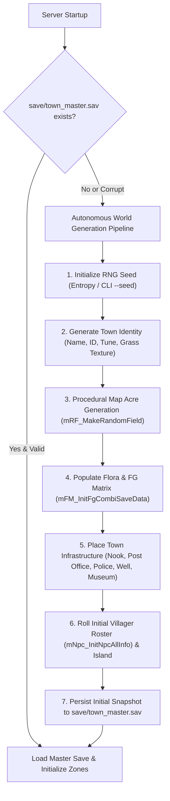

# Specification 001: Authoritative Dedicated Server Architecture

## 1. Overview & Objectives

This specification defines the architecture for an **authoritative, always-on dedicated server** for *Animal Crossing* (GameCube / *Doubutsu no Mori+*) within the native PC port codebase ([`ACGC-PC-Port`](file:///C:/Source/ACGC-PC-Port)).

The server acts as the single source of truth for the persistent town simulation. Multiple clients connect over the network, simultaneously exploring the outdoor town and various indoor rooms (shops, villager homes, museum, post office) without stalling or freezing the world simulation for any other player.

### Core Objectives
1. **Headless 24/7 Execution**: Run as a standalone console daemon on Windows/Linux without requiring an OpenGL window, display lists, or SDL2 audio hardware.
2. **Always-Loaded World & Multi-Zone Simulation**: Maintain the 30 outdoor acres and all occupied indoor rooms concurrently in memory.
3. **Non-Blocking World State**: Completely eliminate global simulation pauses caused by inventory/submenus, dialogue textboxes, cutscenes, and room/acre transitions.
4. **Multi-Player Decoupling**: Generalize the engine's hardcoded singleton player structures to support $N$ simultaneous player entities with proper collision, nearest-player NPC perception, and independent inventory.
5. **Authoritative State & Spatial Replication**: Ensure the server governs foreground items (`fg` tile grid), villager behaviors, shop inventories, and time, streaming delta updates to clients using spatial interest management.

---

## 2. Architectural Boundaries: Server vs. Client



| Subsystem | Server Responsibility | Client Responsibility |
| :--- | :--- | :--- |
| **Simulation Loop** | Fixed 30 Hz tick driving world logic, weather, RTC, and actors. | Variable tick with frame interpolation; predicts local player movement. |
| **Graphics & Rendering** | Completely disabled (stubs for `pc_gx.c`, `emu64`, and display lists). | Full OpenGL 3.3 pipeline translating GameCube GX commands. |
| **Audio Subsystem** | Disabled (stubs for `s_sound`). | Full SDL2 audio, dynamic BGM, environmental sound effects. |
| **World Geometry & Collision** | Evaluates terrain collision (`mCoBG`), water boundaries, and actor hitboxes. | Local predictive collision against cached acre meshes. |
| **Foreground Items (`Save.fg`)** | Authority on tree fruit, buried fossils/gyroids, flowers, weeds, and dropped items. | Render representation; sends action requests (e.g. `REQ_DIG`, `REQ_PICKUP`). |
| **Submenus & Inventory** | Validates item trades, storage, and equips. Does **not** pause on menu open. | Renders pocket GUI, letter writing, catalog. Freezes only local input. |
| **Dialogue & NPCs** | Tracks NPC dialogue progression and busy states; advances villager AI schedules. | Displays text letter-by-letter, voice blips, and choice prompts. |

---

## 3. Subsystem Specifications

### 3.1 Headless Build Target (`TARGET_SERVER`)

A new compilation target must be defined in `pc/CMakeLists.txt`:
* **Compile Flags**: `-DTARGET_PC -DTARGET_SERVER -DHEADLESS`
* **Entry Point**: `pc/src/server/server_main.c`
* **Subsystem Stubs**:
  * `pc_gx.c`: All GX functions (`GXBegin`, `GXEnd`, `GXSetVtxDesc`) become no-ops.
  * `emu64.c`: Display list execution bypasses vertex transform and rasterization.
  * `pc_platform.c`: Skips `SDL_InitSubSystem(SDL_INIT_VIDEO | SDL_INIT_AUDIO)`.
* **Server Tick Loop**:
  ```c
  void server_run_loop(void) {
      const double target_dt = 1.0 / 30.0;
      double accumulator = 0.0;
      uint64_t last_time = pc_get_time_ns();

      while (g_server_running) {
          uint64_t now = pc_get_time_ns();
          double frame_time = (now - last_time) / 1e9;
          last_time = now;
          accumulator += frame_time;

          network_poll_events();

          while (accumulator >= target_dt) {
              server_tick_30hz();
              accumulator -= target_dt;
          }

          pc_sleep_us(1000); // Prevent busy waiting
      }
  }
  ```

---

### 3.2 Multi-Zone Simulation Engine

In vanilla AC, `GAME_PLAY` holds a single `actor_info`, one active `scene_id`, and acre pointers. Entering an indoor room executes `goto_other_scene()`, which unloads the outdoor map. 

The server replaces the single scene container with a **Zone Manager**:

```c
typedef enum {
    ZONE_TYPE_OUTDOOR_TOWN = 0,
    ZONE_TYPE_SHOP,
    ZONE_TYPE_MUSEUM,
    ZONE_TYPE_POST_OFFICE,
    ZONE_TYPE_POLICE_BOX,
    ZONE_TYPE_PLAYER_ROOM,
    ZONE_TYPE_VILLAGER_ROOM,
    ZONE_TYPE_ISLAND
} ZoneType;

typedef struct ServerZone_s {
    uint32_t zone_id;
    ZoneType type;
    int scene_id;
    int is_active;               /* TRUE if at least 1 player is present or persistent simulation required */
    uint32_t player_occupant_mask;

    /* Zone Simulation State */
    Actor_info actor_info;
    CollisionCheck_c collision_check;
    mFI_block_tbl_c block_table;
    Scene_Word_u* scene_data;

    /* Indoor specific data */
    mActor_name_t furniture_layout[16][16];
    struct ServerZone_s* next_zone;
} ServerZone;
```

#### Zone Execution Rules:
1. **Permanent Outdoor Zone (`zone_id = 0`)**: Always initialized and active. Simulates all 30 acres (5×6 grid) continuously.
2. **Dynamic Room Zones**: Created or activated on demand when the first player steps on an entrance trigger (`door_data`). If all players exit an indoor room, its actors are serialized back to `Save` and the zone enters dormant mode to conserve CPU ticks.
3. **Concurrent Ticking**:
   ```c
   void server_tick_zones(void) {
       for (int i = 0; i < MAX_SERVER_ZONES; i++) {
           ServerZone* zone = &g_server_zones[i];
           if (zone->is_active) {
               server_set_active_zone_context(zone);
               Actor_info_call_actor(zone_play_ctx, &zone->actor_info);
               CollisionCheck_OC(zone_play_ctx, &zone->collision_check);
           }
       }
   }
   ```

---

### 3.3 De-Pausing the World & Non-Blocking Dialogue

In vanilla [`src/game/m_play.c`](file:///C:/Source/ACGC-PC-Port/src/game/m_play.c), `Actor_info_call_actor` is gated by `submenu.process_status == mSM_PROCESS_WAIT`.

#### 1. Decoupled Submenus
* `submenu` is stripped from server execution entirely.
* When a client opens their inventory, the client sets a local flag to show UI and ceases transmitting walking vectors.
* The server marks the player entity as `PLAYER_STATE_IN_MENU` (rendering an open-pocket idle animation to other players).
* The world, other players, insects, and fish continue ticking.

#### 2. Non-Blocking Dialogue & Entity Busy Locks
* Dialogue is converted from a global scene mode (`mDemo_Main`) into a per-actor transaction:
  ```c
  typedef struct {
      uint32_t interacting_player_id;
      uint16_t current_msg_id;
      uint8_t branch_choice;
      float timeout_timer;
  } ActorTalkSession;
  ```
* When Player $A$ presses `A` near an NPC:
  1. The server checks `npc->is_busy`. If `TRUE`, a reject packet is sent to Player $A$ (client shows "..." or "Player $B$ is talking to me").
  2. If `FALSE`, `npc->is_busy = TRUE` and `npc->talking_player = Player_A`.
  3. The NPC turns toward Player $A$ and enters a talking animation state.
  4. The dialogue script executes exclusively between the server and Player $A$.
  5. When the conversation completes or Player $A$ disconnects/times out, `npc->is_busy` resets to `FALSE`.

---

### 3.4 Multi-Player Entity Decoupling

The hardcoded singleton references (`Common_Get(now_private)` and `GET_PLAYER_ACTOR_NOW()`) must be refactored into a player registry:

```c
#define MAX_SERVER_CLIENTS 8

typedef struct {
    uint32_t client_id;
    int is_connected;
    uint32_t zone_id;            /* Current zone: 0 for outdoor, >0 for room */
    PLAYER_ACTOR* player_actor;  /* Allocated in zone's actor_info */
    Private_c private_data;      /* Name, pockets, bells, design, face, hair */
    xyz_t predicted_pos;
    s_xyz predicted_angle;
    uint32_t last_ack_input_seq;
} ConnectedClient;

extern ConnectedClient g_server_clients[MAX_SERVER_CLIENTS];
```

#### Nearest-Player Perception in `m_actor.c`:
All actors querying `player_actor->actor_class.world.position` are modified to calculate distance relative to the **nearest player in the same zone**:
```c
PLAYER_ACTOR* Actor_find_nearest_player(ServerZone* zone, xyz_t actor_pos) {
    PLAYER_ACTOR* nearest = NULL;
    float min_dist_sq = 1e9f;

    for (int i = 0; i < MAX_SERVER_CLIENTS; i++) {
        ConnectedClient* client = &g_server_clients[i];
        if (client->is_connected && client->zone_id == zone->zone_id) {
            float dist_sq = search_position_distanceXZ(&actor_pos, &client->player_actor->actor_class.world.position);
            if (dist_sq < min_dist_sq) {
                min_dist_sq = dist_sq;
                nearest = client->player_actor;
            }
        }
    }
    return nearest;
}
```

---

### 3.5 Networking & Spatial Interest Management

#### Transport Protocol
* **Library**: ENet (reliable and unreliable UDP over specified port, default: `21025`).
* **Channels**:
  * `Channel 0 (Unreliable)`: High-frequency player movement inputs and transform broadcasts.
  * `Channel 1 (Reliable)`: State mutations (tool hits, digging, dropping items, buying, talking).
  * `Channel 2 (Reliable)`: Initial world loading, acre tile data, handshakes.

#### Spatial Interest Management (The 3×3 Acre Window)
Instead of streaming all 30 acres to every outdoor client:
* A client standing in Acre $(X, Z)$ is subscribed only to:
  $$\text{Visible Acres} = [X-1, X+1] \times [Z-1, Z+1]$$
* Entity broadcasts (movement, animations, insect flight) are filtered and only transmitted to clients whose interest window intersects that acre.
* Clients inside an indoor room receive updates exclusively from that specific `zone_id`.



---

### 3.6 Packet Definitions

| Packet ID | Direction | Reliability | Payload Description |
| :--- | :--- | :--- | :--- |
| `PKT_C2S_HANDSHAKE` | Client $\rightarrow$ Server | Reliable | Client version, character name, appearance hash, auth token. |
| `PKT_S2C_HANDSHAKE_ACK`| Server $\rightarrow$ Client | Reliable | Assigned `client_id`, world time (`lbRTC`), town name, weather. |
| `PKT_C2S_INPUT` | Client $\rightarrow$ Server | Unreliable | Sequence number, stick X/Y, button mask, current tool ID. |
| `PKT_S2C_ENTITY_SYNC` | Server $\rightarrow$ Client | Unreliable | Frame ID, array of `{actor_id, zone_id, pos, rot, anim_id, state}`. |
| `PKT_C2S_INTERACT_REQ`| Client $\rightarrow$ Server | Reliable | Action type (`DIG`, `SHAKE_TREE`, `HIT_ROCK`, `TALK_NPC`, `ENTER_DOOR`), target coordinates. |
| `PKT_S2C_FG_DELTA` | Server $\rightarrow$ Client | Reliable | Block $(X,Z)$, Tile Index $(u,v)$, Old Item ID, New Item ID. |
| `PKT_S2C_ZONE_ENTER` | Server $\rightarrow$ Client | Reliable | Target `zone_id`, scene ID, spawn coordinate, room furniture layout. |
| `PKT_C2S_DIALOG_INPUT`| Client $\rightarrow$ Server | Reliable | Advance text, selected option index. |
| `PKT_S2C_DIALOG_NODE` | Server $\rightarrow$ Client | Reliable | Speaker Actor ID, String message ID, options bitmask. |

---

### 3.7 World Persistence & Save Journaling

* **Master Town Save**: The server reads and maintains `Save.save` (town name, villagers, foreground matrix, buildings) in memory.
* **Periodic Snapshotting**: Every 5 minutes (and upon server shutdown), the server writes an atomic snapshot to `save/town_master.sav`.
* **Delta Journal**: To prevent corruption or loss between snapshots, every foreground mutation (`PKT_S2C_FG_DELTA`) and economic transaction is written to an append-only write-ahead log (`save/journal.log`).
* **Player Character Isolation**: Player pockets, bells, and personal designs are stored in individual files (`save/players/<uuid>.dat`) to enable players to travel between different servers.

---

### 3.8 Autonomous World Generation & Map Seeding (Bootstrap)

When the server starts up without an existing master save file (`save/town_master.sav`), it must autonomously generate a brand-new, valid GameCube *Animal Crossing* town before accepting any client connections.



#### Map Generation Pipeline Components:
1. **Save Detection**: On startup, `server_storage_init()` attempts to open and validate `save/town_master.sav` using `mFRm_CheckSaveData()`. If the file is missing or reports header errors (`mFRm_ERROR_*`), the bootstrap generator triggers automatically.
2. **Procedural Acre Topology (`mRF_MakeRandomField`)**:
   * Evaluates acre constraints to assemble a 5×6 acre grid (30 total acres).
   * Generates natural elevation boundaries (stepmode: 2-step vs. 3-step cliffs via `mRF_GetRandomStepMode()`).
   * Routes procedural river paths from the northern cliff boundary down to the ocean beach, placing waterfalls, river bends, and mandatory bridges.
   * Places unique required acres: Train Station, Town Hall/Post Office, Tom Nook's Shop, Police Station, Wishing Well, Museum, and Able Sisters.
3. **Foreground Matrix (`Save.fg`) & Flora Population**:
   * Runs `mFM_InitFgCombiSaveData()` to populate each acre tile grid with trees, rocks, signboards, flowers, and weed patches.
   * Selects town native fruit via `decide_fruit()` and transforms designated trees via `mAGrw_ChangeTree2FruitTree()`.
   * Promotes high-elevation trees to cedar trees via `mAGrw_ChangeTree2Cedar()`.
   * Ensures essential movement clearings via `mFI_PullTanukiPathTrees()` and player house plot boundaries.
   * Generates buried fossils, gyroids, and pitfalls in `Save.deposit`.
4. **Villager & Town Registry Initialization**:
   * Assigns unique Land ID (`mLd_LandDataInit()`), town melody (`mMld_SetDefaultMelody()`), and grass pattern (`mFM_DecideBgTexIdx()`).
   * Rolls starting animal villagers (6 initial villagers) with balanced personalities (Lazy, Jock, Cranky, Normal, Peppy, Snooty) using `mNpc_InitNpcAllInfo()`, assigning their house coordinates and default room furniture.
   * Seeds the offshore island layout and islander via `mISL_init()`.
   * Flushes the freshly populated `Save` structure to disk as the new base `town_master.sav`.

